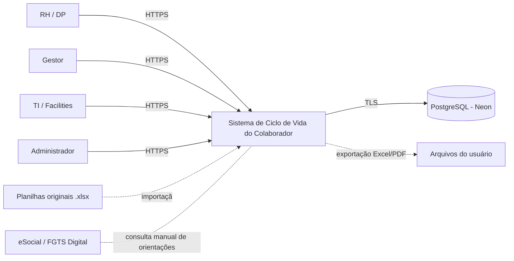
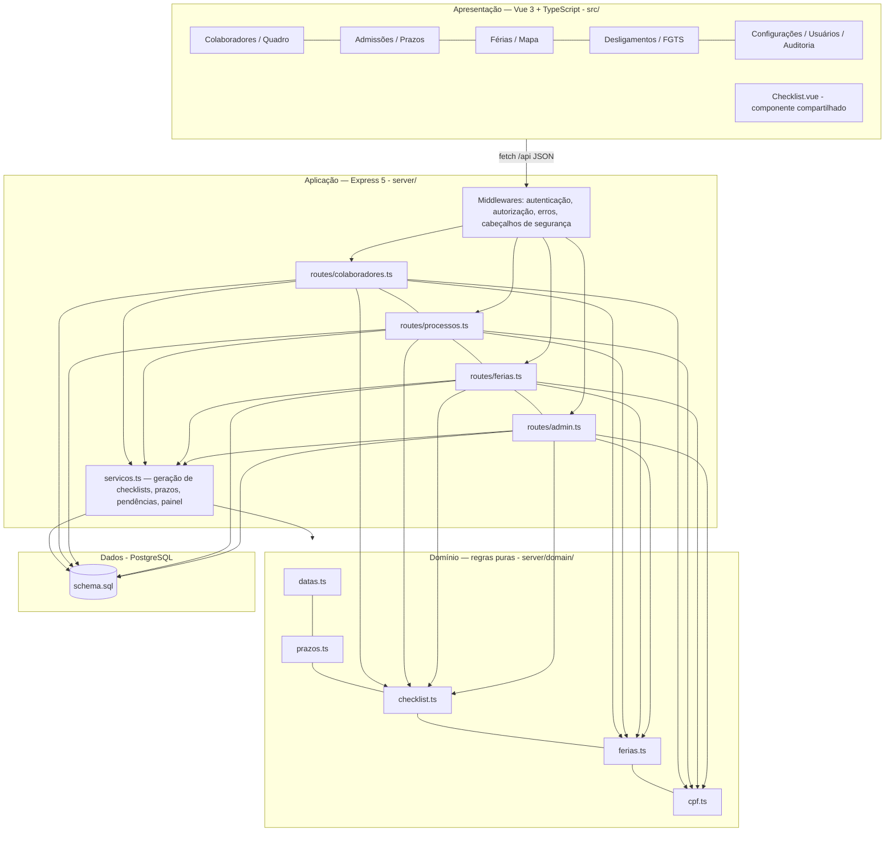
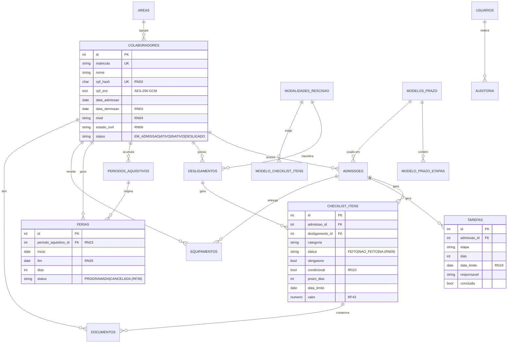
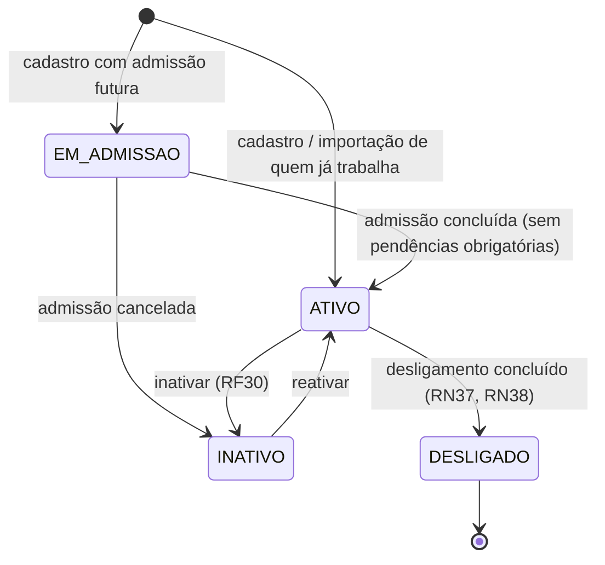
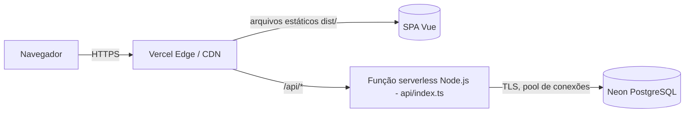

# Descrição de Projeto e Arquitetura de Software (SDD)

**Sistema de Ciclo de Vida do Colaborador — Grupo 2**
Versão 1.0 · Estrutura baseada na **IEEE 1016-2009** (Software Design Descriptions) e na **ISO/IEC/IEEE 42010:2022** (Architecture Description). Áreas do **SWEBOK v4**: *Software Architecture* (cap. 2), *Software Design* (cap. 3), *Software Construction* (cap. 4) e *Software Security* (cap. 13).

| Item | Conteúdo |
|---|---|
| Documento de origem | DRS v2 do Grupo 2 (requisitos RF01–RF53, RNF01–RNF18, RN01–RN40, RI01–RI08) |
| Escopo | Implementação web full-stack implantada na Vercel |
| Público | Equipe do grupo, professor avaliador, futuros mantenedores |

---

## 1. Introdução

### 1.1 Propósito
Descrever as decisões de arquitetura e de projeto tomadas para atender ao DRS, de forma que qualquer requisito possa ser localizado no código (ver `03-matriz-rastreabilidade.md`) e que a solução possa ser mantida e evoluída (RNF18).

### 1.2 Escopo
O sistema centraliza o ciclo de vida da pessoa colaboradora: **cadastro**, **admissão** (checklist + prazos), **férias** (períodos aquisitivos, programação e mapa) e **desligamento** (modalidade de rescisão, checklist, devolução de bens), além de **autenticação, perfis, auditoria, exportação e configurações**.

### 1.3 Definições
| Termo | Significado |
|---|---|
| SPA | *Single Page Application*: interface carregada uma vez no navegador |
| API REST | Interface HTTP/JSON entre interface e servidor |
| Função serverless | Código executado sob demanda pela Vercel, sem servidor dedicado |
| Período aquisitivo | 12 meses de trabalho que geram direito a férias (CLT art. 130) |
| Data de referência | 1º dia de trabalho, base do cálculo de prazos da admissão (RN19) |
| Modelo (template) | Lista configurável de itens/etapas usada para gerar checklists e prazos |

---

## 2. Partes interessadas e preocupações (ISO/IEC/IEEE 42010 §5)

| Parte interessada | Preocupações arquiteturais | Visões que respondem |
|---|---|---|
| RH / Departamento Pessoal | Funcionalidade completa, poucos cliques, prazos corretos | Lógica, Informação |
| Gestores | Consulta sem acesso a dados sensíveis | Segurança |
| TI / Facilities | Equipamentos, acessos | Lógica, Segurança |
| Administrador | Perfis, auditoria, parametrização sem código | Segurança, Informação |
| Pessoa colaboradora (titular dos dados) | Proteção de dados pessoais (LGPD) | Segurança |
| Professor / avaliador | Rastreabilidade, aderência ao SWEBOK/IEEE, sistema na Vercel | Todas + Implantação |
| Equipe de desenvolvimento | Simplicidade, testabilidade, custo zero de hospedagem | Desenvolvimento, Implantação |

---

## 3. Decisões de arquitetura (ADR)

Cada decisão segue o formato *contexto → decisão → consequências*, conforme recomenda o SWEBOK (cap. 2, *Architecture Design Decisions*).

### ADR-01 — Arquitetura em camadas com SPA + API REST + banco relacional
- **Contexto:** o DRS 4.1 separa interface web, API/regras de negócio, autenticação, banco relacional e armazenamento de documentos.
- **Decisão:** três camadas — *Apresentação* (Vue 3 SPA), *Aplicação/Domínio* (API Node.js) e *Dados* (PostgreSQL). As regras de negócio puras ficam isoladas em `server/domain/` (sem acesso a banco ou HTTP).
- **Consequências:** regras testáveis por testes de unidade; troca de interface ou de banco não afeta o domínio (RNF18).

### ADR-02 — Express em vez de NestJS na camada de API
- **Contexto:** o DRS 4.1.1 propôs NestJS "como proposta inicial a ser confirmada". A entrega exige execução na Vercel, que roda a API como **função serverless**. NestJS adiciona tempo de inicialização (*cold start*) e configuração extra de adaptadores nesse modelo.
- **Decisão:** usar **Express 5 + TypeScript**, exposto por uma única função `api/index.ts`. A organização por módulos do NestJS foi mantida por convenção: um roteador por módulo do DRS (`routes/colaboradores.ts`, `routes/processos.ts`, `routes/ferias.ts`, `routes/admin.ts`), validação de entrada com **Zod** (equivalente aos *DTOs/pipes*) e middlewares de autenticação/autorização (equivalentes aos *guards*).
- **Consequências:** implantação sem ajustes na Vercel, menor tempo de resposta inicial; perde-se a injeção de dependências do NestJS (aceitável no porte do projeto). **Atualizar o DRS 4.1.1 com esta decisão.**

### ADR-03 — PostgreSQL com integridade garantida no banco
- **Decisão:** PostgreSQL (Neon, integrado à Vercel). Regras que podem ser garantidas pelo banco viram restrições: `UNIQUE` (CPF — RN02; uma admissão/desligamento aberto por pessoa), `CHECK` (nível — RN04, estado civil — RN06, data de demissão — RN03, "Não se aplica" só em item condicional — RN10, datas de férias — RN25), chaves estrangeiras (RN07, RN08, RN23, RN30).
- **Consequências:** mesmo um erro na aplicação não grava dados inconsistentes (RNF11). Erros de restrição são traduzidos em mensagens com o código da regra.

### ADR-04 — SQL explícito (driver `pg`) em vez de ORM
- **Decisão:** consultas SQL parametrizadas via `pg`. O esquema completo está em `server/schema.sql`.
- **Consequências:** o modelo de dados é legível para a avaliação, não há geração de binários na implantação e as consultas são protegidas contra *SQL injection* por parâmetros (`$1, $2…`).

### ADR-05 — Regras legais como dados configuráveis (RNF06, DRS 2.5)
- **Decisão:** itens de checklist, modalidades de rescisão, etapas de prazo e parâmetros ficam em tabelas (`modelo_checklist_itens`, `modalidades_rescisao`, `modelos_prazo`, `modelo_prazo_etapas`, `parametros`), editáveis pela tela **Configurações**. Itens têm **prazo relativo** (`prazo_dias`) e **vigência** (`vigencia_inicio`/`vigencia_fim`).
- **Exemplo:** "Inscrição no PIS/PASEP" tem vigência até 29/02/2024; admissões posteriores recebem o item automaticamente como "Não se aplica — fora da vigência".
- **Consequências:** mudança de legislação não exige alterar código.

### ADR-06 — Proteção de dados pessoais (RNF01, RNF02)
- **Decisão:** CPF armazenado **cifrado** (AES-256-GCM) e acompanhado de um **HMAC-SHA256** para garantir unicidade sem guardar o CPF em claro. Conexão com o banco por TLS; HTTPS fornecido pela Vercel. Dados sensíveis (CPF completo, RG, salário, CTPS, PIS, documentos) só são entregues pela API a perfis com a permissão `colaborador:sensivel`.
- **Consequências:** a chave `DATA_KEY` não pode ser trocada depois do primeiro cadastro (documentado no guia de implantação).

### ADR-07 — Sessão por JWT em cookie HttpOnly
- **Decisão:** login gera JWT (8 h) gravado em cookie `HttpOnly`, `SameSite=Lax`, `Secure` em produção. Senhas com **bcrypt**. Limite de 5 tentativas de login em 5 minutos por e-mail.
- **Consequências:** o token não fica acessível a scripts da página (mitiga XSS); funciona em ambiente serverless sem estado.

### ADR-08 — Anexos no próprio banco (BYTEA, até 2 MB)
- **Contexto:** a Vercel não oferece disco persistente.
- **Decisão:** anexos (PDF/imagens) gravados em `documentos.conteudo` (BYTEA), limitados a 2 MB e a tipos permitidos.
- **Consequências:** solução simples e sem serviço extra; para volumes maiores, a evolução natural é mover o conteúdo para um *object storage* mantendo a tabela como referência (o DRS 4.1 já prevê "referência ao arquivo no banco").

### ADR-09 — Inicialização automática do banco
- **Decisão:** no primeiro acesso, a API cria o esquema e carrega os **dados extraídos das planilhas** (checklists, modalidades, prazos, parâmetros) e o usuário administrador (`server/seed.ts`), protegido por *advisory lock* e versão de esquema (`schema_meta`).
- **Consequências:** implantar na Vercel não exige rodar scripts manualmente.

---

## 4. Visões de arquitetura

### 4.1 Visão de contexto


Não há integração automática com eSocial ou FGTS Digital (fora do escopo, conforme DRS 4.1).

### 4.2 Visão lógica (módulos e camadas)



| Módulo do DRS (2.6) | Rotas da API | Telas | Regras de domínio |
|---|---|---|---|
| Cadastro | `routes/colaboradores.ts` | `Colaboradores`, `ColaboradorForm`, `ColaboradorDetalhe`, `Quadro` | `cpf.ts` |
| Admissão | `routes/processos.ts` (admissões, itens, equipamentos, documentos) | `Admissoes`, `AdmissaoDetalhe`, `TermoLgpd`, `Checklist` | `checklist.ts` |
| Prazos e tarefas | `routes/processos.ts` (tarefas), `servicos.ts` | `Tarefas`, aba Prazos da admissão, `Painel` | `prazos.ts`, `datas.ts` |
| Férias | `routes/ferias.ts` | `Ferias`, `FeriasColaborador`, `MapaFerias` | `ferias.ts` |
| Desligamento | `routes/processos.ts` (desligamentos, modalidades) | `Desligamentos`, `DesligamentoDetalhe`, `FgtsDigital` | `checklist.ts` |
| Funcionalidades gerais | `routes/admin.ts`, `infra.ts` | `Painel`, `Configuracoes`, `Usuarios`, `Auditoria`, `Login` | — |

### 4.3 Visão de informação (modelo de dados)


A definição completa (tipos, restrições e índices) está em `server/schema.sql`. Correspondência com o DRS 4.2.2: *Colaborador + Dados profissionais* foram mantidos em uma única tabela `colaboradores` (relação 1:1, sem ganho em separar); as demais entidades correspondem uma a uma.

### 4.4 Visão de processo — ciclo de vida da pessoa



Fluxo de conclusão do desligamento (RN31, RN32, RN37–RN39):
```mermaid
sequenceDiagram
  actor RH
  participant UI as Tela de desligamento
  participant API as POST /api/desligamentos/:id/concluir
  participant DB as PostgreSQL
  RH->>UI: Concluir desligamento
  UI->>API: requisição autenticada
  API->>DB: BEGIN; SELECT ... FOR UPDATE
  API->>DB: pendências (itens obrigatórios, modalidade, motivo confirmado, equipamentos não devolvidos)
  alt existem pendências
    API-->>UI: 422 + lista de pendências (RN37)
  else sem pendências
    API->>DB: desligamento = CONCLUIDO; colaborador = DESLIGADO + data_demissao (RN38)
    API->>DB: cancela férias futuras mantendo histórico; grava auditoria
    API->>DB: COMMIT
    API-->>UI: 200
  end
```

### 4.5 Visão de implantação


- `vercel.json`: `/api/*` → função; demais rotas → `index.html` (roteamento da SPA).
- Variáveis de ambiente: `DATABASE_URL`, `JWT_SECRET`, `DATA_KEY`, `ADMIN_EMAIL`, `ADMIN_PASSWORD`.
- Backup (RNF17): *point-in-time restore* do Neon + exportação lógica em JSON pela tela Usuários (`GET /api/admin/backup`).

### 4.6 Visão de segurança — matriz de perfis × permissões (RNF04, RN40)

| Permissão | ADMIN | RH | DP | GESTOR | TI |
|---|:-:|:-:|:-:|:-:|:-:|
| `colaborador:ler` | ✓ | ✓ | ✓ | ✓ | ✓ |
| `colaborador:escrever` | ✓ | ✓ | ✓ | | |
| `colaborador:sensivel` (CPF completo, salário, documentos) | ✓ | ✓ | ✓ | | |
| `processo:ler` | ✓ | ✓ | ✓ | ✓ | ✓ |
| `processo:escrever` (criar/concluir/cancelar processos) | ✓ | ✓ | ✓ | | |
| `checklist:marcar` | ✓ | ✓ | ✓ | | ✓ |
| `equipamento:escrever` | ✓ | ✓ | ✓ | | ✓ |
| `ferias:ler` | ✓ | ✓ | ✓ | ✓ | |
| `ferias:escrever` | ✓ | ✓ | ✓ | | |
| `config:escrever` | ✓ | ✓ | | | |
| `auditoria:ler` | ✓ | ✓ | ✓ | | |
| `usuario:admin` (usuários, backup) | ✓ | | | | |

A matriz está implementada em `server/infra.ts` (`PERMISSOES`) e é verificada em **todas** as rotas pelo middleware `exigir(...)`. A interface apenas esconde botões; a proteção real é no servidor.

---

## 5. Projeto detalhado (IEEE 1016 — *design views*)

### 5.1 Catálogo da API REST

Todas as rotas exigem sessão, exceto `/api/auth/login` e `/api/saude`. Erros retornam `{ erro, detalhes?, campos?, regra? }` com códigos: 400 (validação), 401 (sem sessão), 403 (perfil), 404, 409 (duplicidade), 422 (regra de negócio).

| Método e rota | Requisitos |
|---|---|
| `POST /api/auth/login`, `POST /api/auth/logout`, `GET /api/auth/me`, `POST /api/auth/senha` | RF52 |
| `GET /api/colaboradores?busca=&status=&area_id=` | RF07, RF30 |
| `GET /api/colaboradores/quadro` | RF10 |
| `GET /api/colaboradores/:id` | RF08, RF09 |
| `POST /api/colaboradores`, `PUT /api/colaboradores/:id` | RF01–RF06 |
| `POST /api/colaboradores/:id/status` | RF30 |
| `POST /api/colaboradores/importar` | RNF13 |
| `GET /api/colaboradores/:id/historico` | RF49 |
| `GET/POST /api/admissoes`, `GET/PUT /api/admissoes/:id` | RF11, RF12, RF21 |
| `POST /api/admissoes/:id/concluir`, `/cancelar` | RNF12 |
| `GET /api/admissoes/:id/lgpd` | RF17 |
| `PATCH /api/itens/:id`, `POST /api/{admissoes,desligamentos}/:id/itens`, `DELETE /api/itens/:id` | RF13, RF14, RF43 |
| `GET /api/tarefas`, `PATCH/DELETE /api/tarefas/:id`, `POST /api/admissoes/:id/tarefas` | RF22–RF27 |
| `POST/PATCH/DELETE /api/equipamentos` | RF19, RF20, RF44 |
| `POST /api/documentos`, `GET /api/documentos/:id/download`, `DELETE` | RF18 |
| `GET /api/modalidades` | RF42 |
| `GET/POST /api/desligamentos`, `GET/PUT /api/desligamentos/:id`, `/concluir`, `/cancelar` | RF40–RF47 |
| `GET /api/ferias/colaboradores`, `GET /api/ferias/colaboradores/:id` | RF32, RF33, RF36 |
| `POST /api/ferias/validar`, `POST /api/ferias`, `PUT /api/ferias/:id`, `POST /api/ferias/:id/cancelar` | RF34, RF35, RF39 |
| `GET /api/ferias`, `GET /api/ferias/mapa` | RF36–RF38 |
| `PUT /api/ferias/periodos/:id` (faltas) | RN27 |
| `GET /api/painel` | RF29, RF48 |
| `GET/PUT /api/config/...` (parâmetros, modelos de checklist, modalidades, modelos de prazo, etapas, duplicar) | RF16, RF28, RNF06 |
| `GET/POST/PUT /api/usuarios`, `GET /api/auditoria`, `GET /api/admin/backup` | RF50, RF53, RNF17 |
| `GET /api/fgts-digital` | RF45 |

### 5.2 Algoritmos principais

**Data limite de etapa (RF22, RN19):** `data_limite = data_referência + dias`. Se o parâmetro `prazos_antecipar_fim_de_semana` estiver ativo e a data cair no sábado/domingo, antecipa para a sexta-feira (observação da planilha de prazos). O dia da semana (RF27) é calculado com a mesma convenção do `WEEKDAY()` do Excel.

**Situação da tarefa (RF26, RN20):** `CONCLUIDA` se marcada; `ATRASADA` se `data_limite < hoje`; `VENCE_EM_BREVE` se faltam até `alerta_dias`; senão `NO_PRAZO`. "Hoje" é calculado no fuso America/Sao_Paulo.

**Períodos aquisitivos (RF32, RN22):** a partir da admissão, períodos de 12 meses (`EDATE`), gerados até a data atual.

**Data limite de início das férias (RF33):** fórmula da planilha original: `EDATE(início, 12) + 335` dias (parâmetro `ferias_dias_limite_apos_aquisitivo`).

**Validação de férias (RF34, RF35, RN24–RN29):** pessoa ativa; período aquisitivo concluído; início após o período aquisitivo; sem sobreposição com outras férias; dias de direito conforme faltas (CLT art. 130); até 3 frações, nenhuma menor que 5 dias e uma com pelo menos 14 (CLT art. 134 §1º); início fora de sexta/sábado (art. 134 §3º, parametrizável). Início após a data limite gera **aviso** de férias em dobro (art. 137).

**Progresso do checklist (RF21):** `(feitos + não se aplica) / total`.

**Pendências obrigatórias (RN37, RNF12):** itens `obrigatório` com status `NAO_FEITO`; no desligamento, também modalidade não definida, motivo não confirmado e equipamentos não devolvidos; na admissão, termo de equipamentos não assinado.

### 5.3 Tratamento de concorrência e consistência (RNF15)
Operações que alteram processos rodam em transação com `SELECT … FOR UPDATE` na linha principal, evitando, por exemplo, duas férias conflitantes registradas ao mesmo tempo. Após qualquer alteração a interface recarrega o processo, de modo que percentuais, prazos e pendências ficam sempre consistentes.

---

## 6. Atributos de qualidade (ISO/IEC 25010) × RNF

| Característica ISO 25010 | RNF | Como foi atendido | Evidência |
|---|---|---|---|
| Segurança — confidencialidade | RNF01, RNF02 | CPF cifrado, TLS, dados sensíveis por perfil | CT-I03, CT-I08 |
| Segurança — autenticidade | RNF03 | Login, bcrypt, JWT HttpOnly | CT-I01, CT-I02 |
| Segurança — responsabilização | RNF05 | Tabela `auditoria` em toda alteração | CT-I35 |
| Manutenibilidade — modificabilidade | RNF06, RNF18 | Modelos e parâmetros em tabelas; domínio isolado | CT-I36 |
| Usabilidade — operabilidade | RNF07, RNF16 | Marcação de item em 1 clique; componente de checklist único | CA-08 |
| Portabilidade — adaptabilidade | RNF08, RNF14 | CSS responsivo; navegadores modernos | CA-10 |
| Eficiência de desempenho | RNF09 | Checklist (~40 itens) em uma requisição | CT-I20 |
| Confiabilidade — disponibilidade | RNF10, RNF17 | Vercel + Neon; backup JSON | CT-I37 |
| Adequação funcional — correção | RNF11, RNF12 | Restrições no banco + validação Zod | CT-I05, CT-I06, CT-I18, CT-I30 |
| Compatibilidade — interoperabilidade | RNF13 | Importação do .xlsx original; exportação Excel | CT-I10 |

---

## 7. Padrões de construção (SWEBOK cap. 4)
- **Linguagem:** TypeScript em modo `strict` no servidor e no cliente (`npm run typecheck`).
- **Validação:** toda entrada externa passa por um esquema Zod antes de chegar ao banco.
- **SQL:** sempre parametrizado; nenhuma concatenação de valores do usuário.
- **Nomes:** em português, iguais aos termos do DRS (glossário compartilhado).
- **Rastreabilidade no código:** comentários citam o identificador do requisito/regra (ex.: `// RN37`), permitindo localizar a implementação com uma busca.
- **Gerência de configuração (SWEBOK cap. 8 / IEEE 828):** repositório Git, branch `main` protegida, uma branch por funcionalidade, *pull request* revisado por outro integrante, deploy automático da Vercel a cada push na `main` e *preview* por PR.
